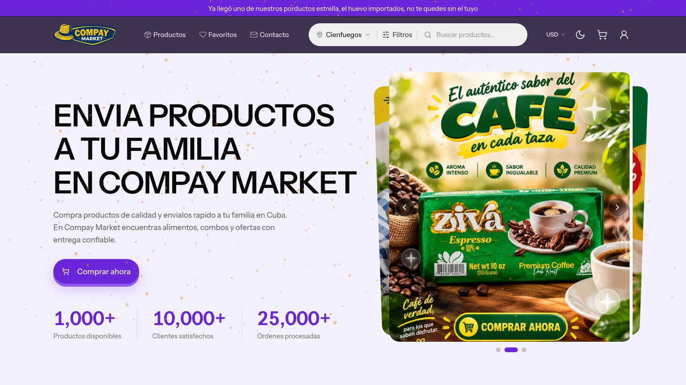
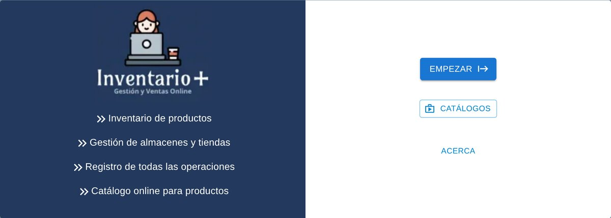
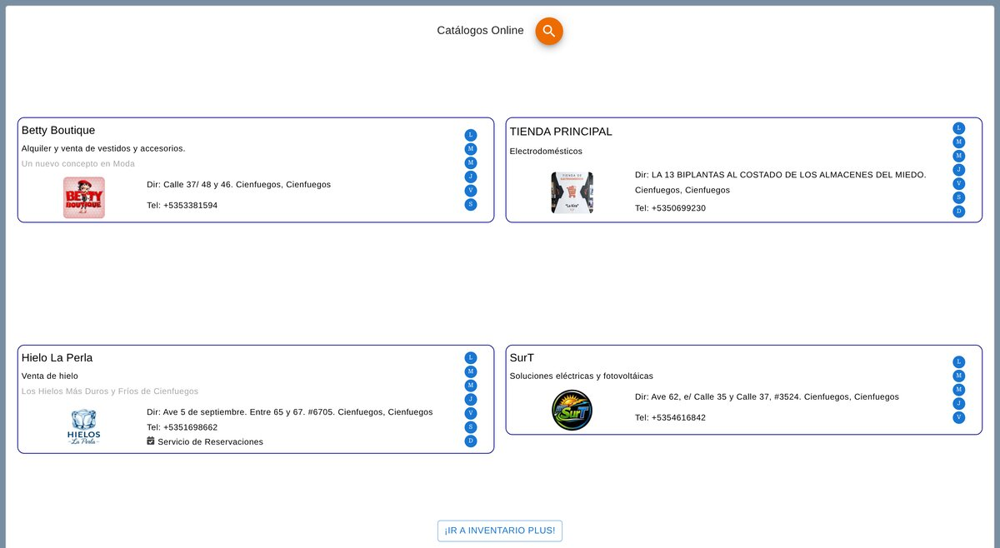
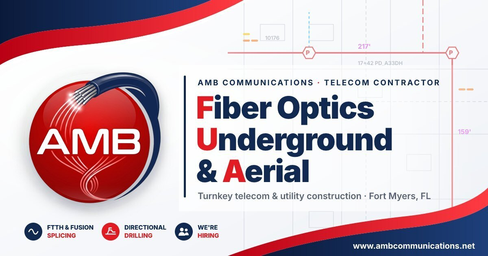
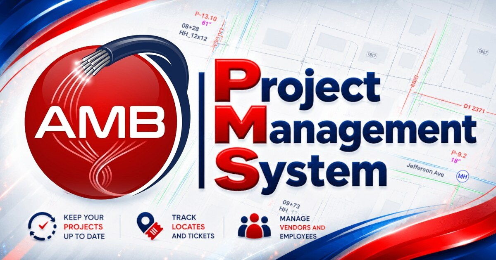
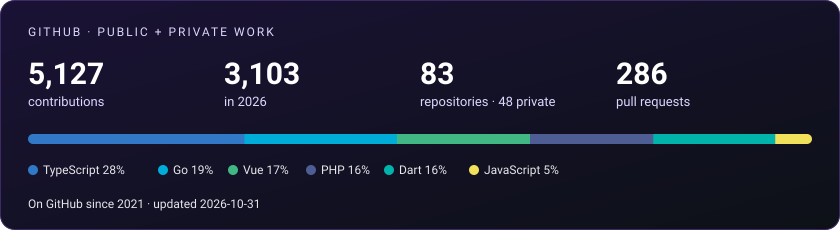
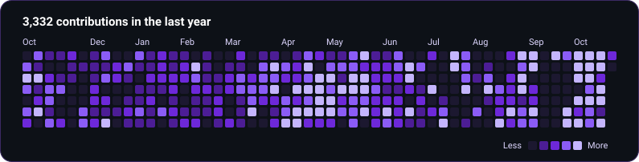
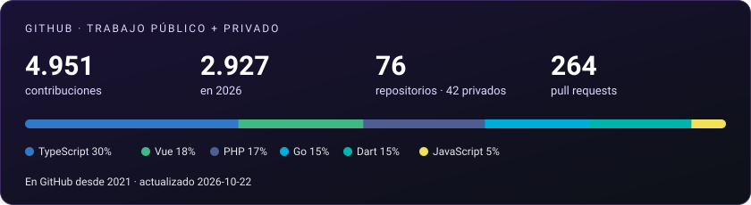
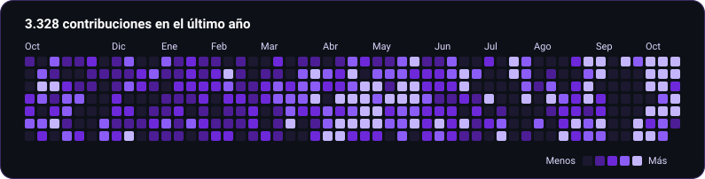

<b>English version</b> — click to read this profile in English

 

## About me

I'm **Alexis**, a Software Engineer from **Cienfuegos, Cuba** with **8 years of experience** (since 2018) building production software end to end: from the spec and the database to the mobile app and the server it runs on.

- **Chief Technology Officer at Domino Real**: I lead the whole platform, from architecture to deployment.
- Backend first: **Go**, **Laravel** and **Python**; microservices, GraphQL, WebSockets and gRPC.
- **Spec Driven Development**: the spec is written before the code, and the code is tested against it.
- **DevOps**: CI/CD, Docker, automated deploys, observability and Linux servers.
- I enjoy refactoring and clean architecture.
- I speak Spanish and English.

## Domino Real — Chief Technology Officer

Realtime multiplayer domino: 4-seat tables, solo and pairs, cash and all-in modes, clubs and unions with a hierarchical chip economy (player → agent → super agent → club → union), and a full admin panel.

- **Backend:** Go · Gin · gqlgen (GraphQL) · two WebSocket channels with lean per-move deltas and sequence numbers · PostgreSQL + PgBouncer · Redis bus · Prometheus metrics
- **App:** Flutter (Android / iOS) · BLoC · realtime game table, push notifications, deep links
- **Admin & web:** Vue + Inertia admin panel embedded in the Go binary · Astro public site
- **Ops:** Docker Compose, GitHub Actions CI/CD to DigitalOcean, signed APKs published automatically

## Compay Market

The widest-reaching project I've worked on: the e-commerce platform for sending products to families in Cuba. Catalog and stock by province and municipality, bundles and deals, USD payments and home delivery; **1,000+ products, 10,000+ customers and 25,000+ orders processed**.

Storefront, admin panel and supplier portal in Laravel + Inertia + Vue.

     

## Inventario Plus

<table>
<tr>
<td width="50%" valign="top"></td>
<td width="50%" valign="top"></td>
</tr>
</table>

Online inventory and business management: product inventory, warehouses and stores, a log of every operation and **public online catalogs** for each business, with opening hours, contact and bookings. Used by real businesses in Cienfuegos.

## Featured work

<table>
<tr>
<td width="50%" valign="top">

<h3><a href="https://www.ambcommunications.net/">AMB Communications</a></h3>

Website and admin for a telecom and utility contractor in Florida: services, projects, careers with applicant tracking, bilingual (EN / ES), SEO.

   
</td>
<td width="50%" valign="top">

<h3><a href="https://vendors.ambcommunications.net/">AMB Vendors</a></h3>

Field operations platform: interactive project maps, jobs and labors, crews and vendors, 811 locates and tickets, invoicing, field photos and documents.

   
</td>
</tr>
</table>

### Other projects I built

- **[Diego Reverte](https://app.diegoreverte.com/)** — Platform for a nutrition practice: a dietitian dashboard and a private patient portal.
- **[Reseteat](https://comunidadreseteat.com/)** — Online therapeutic community: support for addiction recovery and personal growth.

**Also contributed to:** [Davivienda](https://davivienda.com/) · [Emyux](https://emyux.com/)

## Tech stack

<table>
<tr><td align="right"><b>Frontend</b></td><td>          </td></tr>
<tr><td align="right"><b>Mobile</b></td><td> </td></tr>
<tr><td align="right"><b>Backend</b></td><td>       </td></tr>
<tr><td align="right"><b>Databases</b></td><td>     </td></tr>
<tr><td align="right"><b>Tools &amp; DevOps</b></td><td>         </td></tr>
</table>

## GitHub stats

Private work counts as totals only: no repository is exposed.

## Let's work together

Open to backend, fullstack and DevOps work, freelance or full time. The fastest way to reach me is email or WhatsApp.

  
  
  
  
  
  

## Sobre mí

Soy **Alexis**, ingeniero de software de **Cienfuegos, Cuba**, con **8 años de experiencia** (desde 2018) construyendo software en producción de punta a punta: desde la especificación y la base de datos hasta la app móvil y el servidor donde corre.

- **Director de Tecnología (CTO) en Domino Real**: lidero toda la plataforma, de la arquitectura al despliegue.
- Backend primero: **Go**, **Laravel** y **Python**; microservicios, GraphQL, WebSockets y gRPC.
- **Spec Driven Development**: la especificación se escribe antes que el código, y el código se prueba contra ella.
- **DevOps**: CI/CD, Docker, despliegues automatizados, observabilidad y servidores Linux.
- Me encanta refactorizar y la arquitectura limpia.
- Hablo español e inglés.

## Domino Real — Director de Tecnología (CTO)

Dominó multijugador en tiempo real: mesas de 4 asientos, individual y por parejas, modos cash y all-in, clubes y uniones con una economía de fichas jerárquica (jugador → agente → super agente → club → unión) y un panel de administración completo.

- **Backend:** Go · Gin · gqlgen (GraphQL) · dos canales WebSocket con deltas mínimos por jugada y números de secuencia · PostgreSQL + PgBouncer · bus Redis · métricas Prometheus
- **App:** Flutter (Android / iOS) · BLoC · mesa de juego en tiempo real, notificaciones push, deep links
- **Admin y web:** panel Vue + Inertia embebido en el binario de Go · sitio público en Astro
- **Ops:** Docker Compose, CI/CD con GitHub Actions hacia DigitalOcean, APKs firmados publicados automáticamente

## Compay Market

El proyecto de mayor alcance en el que he trabajado: la plataforma de comercio electrónico para enviar productos a familias en Cuba. Catálogo y existencias por provincia y municipio, combos y ofertas, pagos en USD y entrega a domicilio; **más de 1.000 productos, 10.000 clientes y 25.000 órdenes procesadas**.

Tienda, panel de administración y portal de proveedores en Laravel + Inertia + Vue.

     

## Inventario Plus

<table>
<tr>
<td width="50%" valign="top"></td>
<td width="50%" valign="top"></td>
</tr>
</table>

Sistema de inventario y gestión de negocios en línea: inventario de productos, gestión de almacenes y tiendas, registro de todas las operaciones y **catálogos online públicos** para cada negocio, con horarios, contacto y reservaciones. Lo usan negocios reales de Cienfuegos.

## Proyectos destacados

<table>
<tr>
<td width="50%" valign="top">

<h3><a href="https://www.ambcommunications.net/">AMB Communications</a></h3>

Sitio web y panel de administración de un contratista de telecomunicaciones en Florida: servicios, proyectos, empleos con seguimiento de candidatos, bilingüe (EN / ES) y SEO.

   
</td>
<td width="50%" valign="top">

<h3><a href="https://vendors.ambcommunications.net/">AMB Vendors</a></h3>

Plataforma de operaciones de campo: mapas interactivos de proyectos, trabajos y labores, cuadrillas y proveedores, tickets 811, facturación, fotos y documentos de obra.

   
</td>
</tr>
</table>

### Otros proyectos que construí

- **[Diego Reverte](https://app.diegoreverte.com/)** — Plataforma para una consulta de nutrición: panel del dietista y portal privado del paciente.
- **[Reseteat](https://comunidadreseteat.com/)** — Comunidad terapéutica online: acompañamiento en procesos de adicción y crecimiento personal.

**También participé en:** [Davivienda](https://davivienda.com/) · [Emyux](https://emyux.com/)

## Tecnologías

<table>
<tr><td align="right"><b>Frontend</b></td><td>          </td></tr>
<tr><td align="right"><b>Móvil</b></td><td> </td></tr>
<tr><td align="right"><b>Backend</b></td><td>       </td></tr>
<tr><td align="right"><b>Bases de datos</b></td><td>     </td></tr>
<tr><td align="right"><b>Herramientas y DevOps</b></td><td>         </td></tr>
</table>

## Estadísticas de GitHub

El trabajo privado solo cuenta como totales: no se expone ningún repositorio.

## Trabajemos juntos

Disponible para trabajos de backend, fullstack y DevOps, freelance o a tiempo completo. La forma más rápida de contactarme es por email o WhatsApp.

  
  
  
  
  
  

